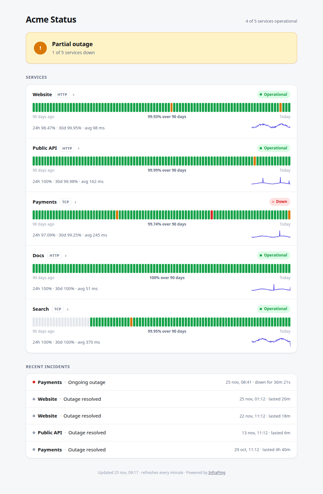

# InfraPing

**Self-hosted uptime monitoring in a single binary: one YAML file describes what to watch and who to wake up.**



## What it is

InfraPing probes your websites, APIs, open ports, TLS certificates and DNS records on a schedule. When something stays broken it alerts you on Telegram, Discord, Slack, ntfy or any webhook, and it tells you again when it comes back. It also serves a public status page with 90 days of uptime history.

It is meant for homelabs, side projects and small teams who want something between a cron job that runs `curl` and a full observability stack. It has no database, no runtime dependencies and no account to create. Everything lives in one config file, and secrets come from environment variables.

## Why it is built this way

- **One static binary.** Go and `CGO_ENABLED=0` produce a ~15 MB executable that runs on a VPS, a Raspberry Pi or a `distroless` container without installing anything else.
- **Confirmed state, not raw failures.** Each check goes through a small state machine with failure and recovery thresholds. A single dropped packet does not page anyone, an outage is reported once and not every minute, and its start time is the first failure, not the one that confirmed it.
- **Restarts do not lose anything.** History and the current outage are written atomically to a JSON file. After a restart InfraPing neither repeats a "down" alert nor misses the "recovered" one.
- **A public page that leaks nothing.** The status page shows names, uptime and latency, never targets or error messages, so internal hostnames and IPs stay private. Checks can also be hidden from it entirely.
- **Strict config.** Unknown keys are errors and all problems are reported together, so a typo like `intervall:` fails at startup instead of being silently ignored.

## How it works

1. On start, InfraPing loads the config, expands `${VARIABLES}` in values (not in comments), applies defaults and validates everything.
2. Each check runs in its own goroutine at its own interval, with a small random offset so probes do not all fire at once.
3. Each result is recorded (every sample for 24 hours, plus one aggregate per day for 90 days) and fed to the check's state machine.
4. When the state machine confirms a transition (up → down or down → up), the alert goes to the check's notifiers in parallel, with retries and exponential backoff.
5. The status page and `/api/status` read the same in-memory history. The history is saved to disk every minute and on shutdown.

## Architecture

```text
infraping/
├── cmd/infraping/        CLI: run, check, validate, test-notify, version
├── internal/config/      YAML loading, env expansion, defaults, validation
├── internal/check/       Probes: http, tcp, tls (certificate expiry), dns
├── internal/monitor/     Outage state machine and the scheduler that ties everything together
├── internal/history/     24h samples + 90 daily aggregates, atomic JSON persistence
├── internal/notify/      Telegram, Discord, Slack, ntfy and webhook senders with retries
├── internal/status/      Status page (embedded HTML template), JSON API, /healthz
├── examples/             Annotated example configuration
├── scripts/              build-release.sh: cross-compiled archives + SHA256SUMS
├── worker/               Serverless edition for Cloudflare Workers (TypeScript, cron + D1)
└── Dockerfile            Multi-stage build into a distroless, non-root image
```

## Installation

### Prebuilt binaries

Every [release](https://github.com/juanmmm21/infraping/releases) ships static binaries for Linux, macOS and Windows on amd64 and arm64, plus a `SHA256SUMS` file:

```bash
curl -LO https://github.com/juanmmm21/infraping/releases/download/v0.1.0/infraping_0.1.0_linux_amd64.tar.gz
curl -LO https://github.com/juanmmm21/infraping/releases/download/v0.1.0/SHA256SUMS
sha256sum -c --ignore-missing SHA256SUMS
tar xzf infraping_0.1.0_linux_amd64.tar.gz
./infraping_0.1.0_linux_amd64/infraping version
```

### From source (Go 1.24+)

```bash
go install github.com/juanmmm21/infraping/cmd/infraping@latest
```

Or clone and build:

```bash
git clone https://github.com/juanmmm21/infraping.git
cd infraping
CGO_ENABLED=0 go build -trimpath -o infraping ./cmd/infraping
```

### Docker

A multi-arch image (`linux/amd64`, `linux/arm64`) is published to GitHub Container Registry:

```bash
docker run -d --name infraping \
  -p 8080:8080 \
  -v "$PWD/infraping.yaml:/config/infraping.yaml:ro" \
  -v infraping-data:/data \
  -e TELEGRAM_BOT_TOKEN -e TELEGRAM_CHAT_ID \
  ghcr.io/juanmmm21/infraping:0.1
```

Tags follow the release: `0.1.0`, `0.1` and `latest`. To build the image yourself, run `docker build -t infraping .` and use `infraping` as the image name.

The image reads `/config/infraping.yaml` and runs from `/data`, so `state_file: ./state.json` keeps history in the volume.

### Cloudflare Workers (serverless)

If you would rather not run a server at all, `worker/` holds a serverless edition that runs on Cloudflare's free plan. A cron trigger fires every minute, history lives in a D1 database, and the Worker serves the same status page and `/api/status`.

It reads the same YAML format, with three differences that come from the Workers runtime:

- there are no `tls` checks, because a Worker cannot inspect a server's certificate;
- DNS checks always go through Cloudflare's DNS-over-HTTPS, so `resolver` is not available;
- the shortest `interval` is `1m`, which is how often the cron fires. `skip_tls_verify` is not supported either.

Anything the Worker cannot do is a validation error, so nothing is silently left unwatched.

The free plan allows 50 outgoing requests and 10 ms of CPU per run. Each `http` or `tcp` check uses one request per run, a `dns` check uses two, and each alert uses one per notifier (up to three with retries). Samples are stored in a compact columnar form, so loading and saving the history of 20 checks takes about 4 ms. Up to about 20 checks fits the free plan comfortably; for more, use the binary or a paid Workers plan.

```bash
cd worker
npm install
cp infraping.example.yaml infraping.yaml        # edit it; it is bundled into the Worker
npx wrangler login
npx wrangler secret put TELEGRAM_BOT_TOKEN       # one per ${VARIABLE} in the YAML
npx wrangler secret put TELEGRAM_CHAT_ID
npx wrangler deploy                              # creates the D1 database on first deploy
```

To try it locally, without an account: put the variables in `worker/.dev.vars` (`NAME=value`, one per line), run `npm run dev`, and trigger a run with `curl "http://localhost:8787/cdn-cgi/local/scheduled"`. Local runs use a local D1.

## Usage

Copy [`examples/infraping.example.yaml`](examples/infraping.example.yaml) to `infraping.yaml` and edit it. A minimal config:

```yaml
notifiers:
  - name: phone
    type: telegram
    token: ${TELEGRAM_BOT_TOKEN}
    chat_id: ${TELEGRAM_CHAT_ID}

checks:
  - name: Website
    type: http
    url: https://example.com
    contains: "Example Domain"
```

Then:

```bash
infraping validate -c infraping.yaml     # check the file
infraping test-notify -c infraping.yaml  # make sure every notifier reaches you
infraping run -c infraping.yaml          # watch, alert and serve the status page
```

`infraping check` runs every probe once and exits with `1` if any fails. That makes it handy in CI or a cron job:

```text
$ infraping check -c infraping.yaml
STATUS  CHECK            LATENCY  DETAIL
UP      Website          45ms     status 200
UP      TLS certificate  86ms     certificate valid for 64 days
UP      DNS              9ms      resolves to 172.66.147.243, 104.20.23.154
DOWN    Database         0s       connect 127.0.0.1:5432: dial tcp 127.0.0.1:5432: connect: connection refused

1 of 4 checks failing
```

The config path can also come from `$INFRAPING_CONFIG`.

### Reloading the configuration

Send `SIGHUP` to apply an edited file without stopping the process (`kill -HUP <pid>`, or `docker kill -s HUP infraping`). The new file is validated first; if it has an error, InfraPing logs it and keeps running with the previous configuration. On a successful reload:

- checks, notifiers, defaults and the status page title take effect immediately;
- checks that keep their name keep their history, and a check that was down stays down, so no duplicate alert is sent;
- removed checks lose their history;
- `state_file`, `status_page.enabled` and `status_page.listen` need a restart: a reload logs a warning and keeps the old values.

## Configuration reference

### Top level

- `defaults`: `interval` (default `60s`), `timeout` (`10s`), `failure_threshold` (`2`) and `recovery_threshold` (`1`). These apply to every check that does not set its own.
- `state_file`: path for the persisted history. If omitted, history lives in memory only.
- `status_page`: `enabled` (default `false`), `listen` (`:8080`) and `title`.
- `notifiers`: list of alert destinations.
- `checks`: list of things to watch.

### Checks

Common fields: `name` (required, unique), `type`, `interval`, `timeout`, `failure_threshold`, `recovery_threshold`, `max_latency` (a slower answer counts as a failure), `notify` (notifier names; omit to alert all) and `public` (default `true`).

- **`http`**: `url`, `method` (`GET`), `headers`, `expect_status` (a list; default is any 2xx or 3xx), `contains` (text that must appear in the first 1 MB of the body) and `skip_tls_verify`.
- **`tcp`**: `address` as `host:port`. Succeeds if a connection opens.
- **`tls`**: `address` as `host:port` and `min_days_left` (default `14`). Fails on an invalid chain or a certificate closer to expiry than that.
- **`dns`**: `host`, optional `resolver` (`1.1.1.1:53`) and `expect_ips` (at least one must be among the answers).

### Notifiers

- **`telegram`**: `token` and `chat_id`.
- **`discord`**: `url`, the channel webhook URL.
- **`slack`**: `url`, the incoming webhook URL.
- **`ntfy`**: `topic`, `server` (default `https://ntfy.sh`) and an optional `token` for protected topics.
- **`webhook`**: `url` and optional `headers`. It receives a JSON POST:

```json
{
  "kind": "down",
  "check": "API",
  "target": "https://api.example.com/healthz",
  "reason": "unexpected status 503",
  "at": "2026-05-01T08:30:00Z",
  "title": "🔴 API is DOWN",
  "text": "Target: https://api.example.com/healthz\nReason: unexpected status 503\nAt: 2026-05-01 08:30:00 UTC"
}
```

`kind` is `down`, `recovered` or `test`. Recoveries also carry `downtime_seconds`.

### HTTP endpoints (when the status page is enabled)

- `GET /`: the status page. It refreshes itself every minute and follows the system's light or dark theme.
- `GET /api/status`: the same data as JSON, with CORS open so other sites can embed it.
- `GET /healthz`: returns `ok`, for the container's or load balancer's own health check.

## Development

```bash
go test -race ./...
go vet ./...
go run honnef.co/go/tools/cmd/staticcheck@latest ./...
gofmt -l .
```

The tests never touch the internet. HTTP, TLS and notifier tests run against local `httptest` servers, and the end-to-end CLI test starts `infraping run` against a closed local port and a local webhook.

The Worker has its own checks, which CI also runs:

```bash
cd worker
npm ci
npm run typecheck
npm test
```

Its tests inject `fetch` and the TCP `connect`, so they do not touch the internet either.

### Releasing

Pushing a `vX.Y.Z` tag runs `.github/workflows/release.yml`, which tests the code and then, in parallel:

- builds static binaries for Linux, macOS and Windows on amd64 and arm64 with `scripts/build-release.sh` and attaches them, with a `SHA256SUMS` file, to a GitHub release;
- builds a multi-arch (`linux/amd64`, `linux/arm64`) image and pushes it to `ghcr.io/juanmmm21/infraping` as `X.Y.Z`, `X.Y` and `latest`.

Tags with a hyphen (`v1.0.0-rc.1`) become prereleases and do not move `latest`. To build the same archives locally: `./scripts/build-release.sh v0.0.0-dev` (output in `dist/`).

## Troubleshooting

- **`config references unset environment variables: X`**: every `${X}` in a value must be set when InfraPing starts. With Docker, pass it with `-e X` or an `--env-file`.
- **`field intervall not found in type config.CheckConfig`**: a typo in a key. InfraPing rejects unknown keys on purpose.
- **A TLS check fails with `certificate signed by unknown authority`**: the server presents a self-signed or incomplete chain. Fix the chain, or use an `http` check with `skip_tls_verify: true` if the service is internal.
- **No alerts arrive**: run `infraping test-notify -c infraping.yaml`. It sends one message through each notifier and prints exactly what each service answered.

## License

MIT, see [LICENSE](LICENSE).
